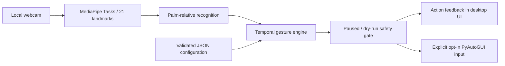

# Architecture and engineering decisions

## Data flow

### Recognition is not action

The recognition layer classifies a single hand observation. Palm-relative distances replace pixel thresholds so changing preview resolution does not directly change the pinch threshold. Finger joint geometry avoids relying only on fingertip screen height. This is a geometric heuristic, not a custom-trained gesture classifier; perspective, occlusion, depth scaling, and hand shape remain limitations.

The temporal engine converts observations into actions using monotonic time, pose stabilization, pointer smoothing, scroll anchoring, dead zones, rate limits, and pinch release hysteresis. A held pinch is a single edge, not a click every frame. Scroll output is wheel ticks, not pixels. Actions are evaluated per observation; there is no autonomous scroll worker continuing after hand loss.

### Safety belongs at the boundary

The application starts paused and in dry-run mode. Previewing recognition must not import or initialize an OS input backend. Real input requires a separate opt-in and explicit resume. Pausing, changing input mode, and tracking loss reset transient gesture state. Backend failures pause input instead of continuing blindly. PyAutoGUI's corner fail-safe stays enabled.

Keyboard output is intentionally allowlisted: the optional media play/pause action is not arbitrary command execution. There is no shell-command gesture mapping, drag mode, or destructive shortcut by default.

### Hardware adapters stay optional

The distributable core and deterministic demo run without OpenCV, MediaPipe, Tkinter, a webcam, or a display server. Desktop extras provide camera, inference, image rendering, and OS input. MediaPipe Tasks is used instead of the legacy `mediapipe.python.solutions` interface. The model is supplied explicitly by the user; the application does not fetch models at startup.

Tkinter provides a native local desktop surface rather than a web service. The computer running the process owns the webcam and is the only computer whose input it can control. LAN hosting would not control another PC's desktop and is deliberately not part of this project.

## Privacy and threat boundary

Frames are processed in the local process. The intended runtime does not record frames, upload video, expose a network listener, or load remote commands. Installation and explicit model download require internet access; normal inference does not. The OS input backend can affect the focused application, so use a disposable document during initial testing and keep a physical mouse/keyboard available.

## Verification layers

- Geometry and policy: deterministic fixtures, including transformed and malformed landmarks.
- Safety and lifecycle: injected adapters for paused/dry-run state, dispatch errors, camera failure, and cleanup.
- Packaging: CLI smoke test, isolated wheel installation, sdist/wheel build.
- CI: Windows/Linux headless tests, lint, formatting, and packaging.
- Device acceptance: [manual checklist](MANUAL_TESTING.md), intentionally separate from simulated verification.

## Deliberate limits

One tracked hand; no personalized calibration or accuracy guarantee; no global emergency hotkey; primary-monitor pointer mapping; no general Wayland support. Multi-monitor DPI behavior and real Windows camera/input operation need device testing. A future release can add explicit calibration, user-tested gesture profiles, and signed installers after the interaction is validated.
